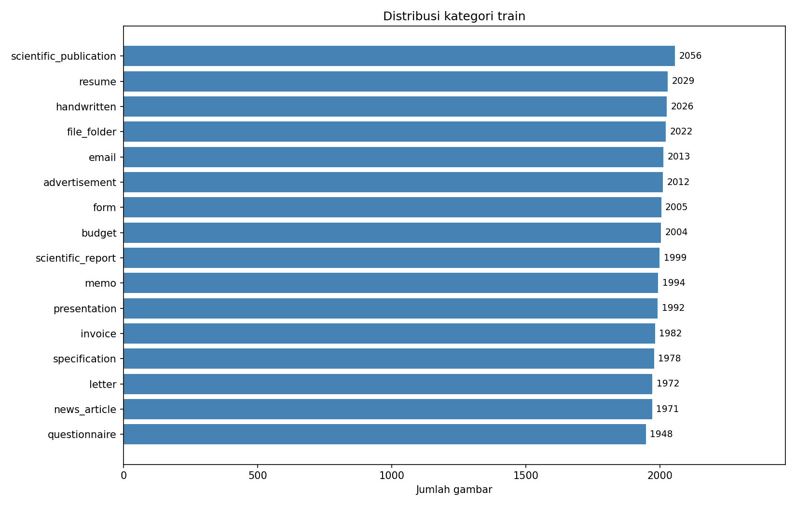
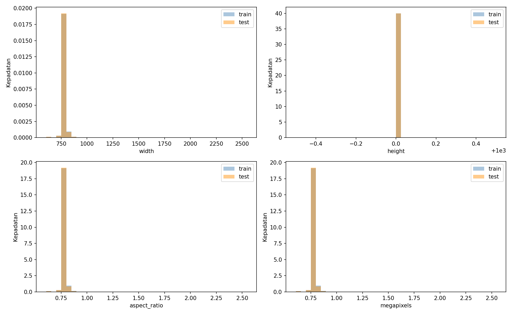
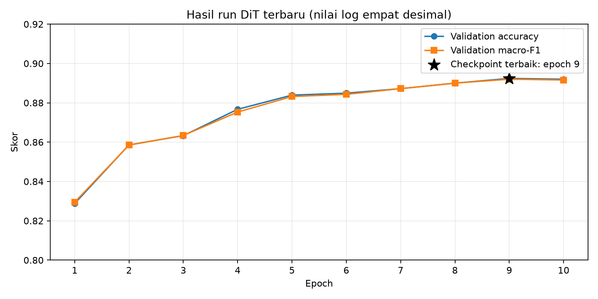

# Klasifikasi gambar dokumen dengan DiT

Jason Alexander Widodo / 5052241001

Proyek ini dibuat untuk Tugas 2 supervised machine learning. Tujuannya adalah mengenali jenis dokumen dari gambar, misalnya surat, invoice, email, dan formulir. Ada 16 kategori yang diprediksi.

Model yang digunakan adalah DiT (`microsoft/dit-base`) dengan PyTorch. Training dan prediksi dilakukan di Kaggle Notebook menggunakan GPU.

## Hasil

| Penilaian | Nilai |
| --- | --- |
| Validation accuracy | 0,89236 atau sekitar 89,24% |
| Public score | 0,89711 |
| Validation macro-F1 | 0,89198 |
| Validation loss model terbaik | 0,42974 |
| Epoch model terbaik | 9 |

Validation accuracy dihitung dari sebagian data train yang dipisahkan untuk menguji model. Public score diperoleh setelah file prediksi dikirim ke Kaggle. Keduanya menggunakan data penilaian yang berbeda. Nilai lengkapnya tersimpan di `reports/metrics.json`. Public score 0,89711 berasal dari run sebelumnya dan belum dikaitkan dengan submission terbaru.

## Data

Dataset terdiri dari 32.003 gambar train dan 7.994 gambar test. Gambar train memiliki label, sedangkan label gambar test harus diprediksi oleh model.

Buka [kompetisi Kaggle](https://www.kaggle.com/t/ec93bc56cc9842959bb6728723d23d29), lalu tambahkan data kompetisi ke notebook. Jika ingin mengunduhnya, buka tab Data dan unduh `train.zip`, `test.zip`, `train.csv`, `test.csv`, serta `sample_submission.csv`.

Dataset tidak diunggah ke GitHub.

## Temuan EDA

Jumlah sampel per kelas berkisar antara 1.948 dan 2.056 gambar. Kelas terbesar adalah `scientific_publication` dan kelas terkecil adalah `questionnaire`. Rasio jumlah keduanya sekitar 1,055, sehingga jumlah sampel antarkelas relatif serupa.

Pada file yang berhasil diperiksa, seluruh gambar memiliki tinggi 1.000 piksel, mode grayscale, dan satu halaman TIFF. Resolusi paling sering ditemukan adalah 754 x 1.000 piksel. Satu file train gagal dibaca metadatanya, sedangkan seluruh metadata test dapat dibaca. Pemeriksaan ini belum memuat seluruh piksel karena `READ_PIXELS=False` pada run EDA.





Contoh gambar setiap kategori, sampel test, dan gambar dengan ukuran ekstrem tersedia pada [daftar gambar EDA](reports/figures/README.md).

## Isi folder

```text
.
├── README.md
├── requirements.txt
├── .gitignore
├── configs/
├── notebooks/
│   ├── 01_eda.ipynb
│   ├── 02_train_predict.ipynb
│   └── 03_evaluation.ipynb
├── scripts/
│   └── train_kaggle.py
├── reports/
├── data/
├── checkpoint/
└── outputs/
```

- `configs/classes.json`: daftar kategori untuk label 0 sampai 15.
- `notebooks/`: pemeriksaan data, training, dan evaluasi.
- `scripts/train_kaggle.py`: kode lengkap yang dapat langsung disalin ke Kaggle.
- `reports/`: laporan, tabel hasil, dan grafik.
- `checkpoint/`: tempat menyimpan model hasil training.
- `outputs/`: tempat menyimpan hasil program.

## Cara menjalankan di Kaggle

### 1. Siapkan notebook

Buat Kaggle Notebook, lalu tambahkan dataset kompetisi melalui panel Input. Pada pengaturan notebook, aktifkan GPU dan Internet.

Jalankan sel ini untuk memastikan GPU tersedia:

```python
import torch

assert torch.cuda.is_available(), "Aktifkan GPU pada pengaturan notebook."
print("GPU:", torch.cuda.get_device_name(0))
```

### 2. Instal library tambahan

Jalankan sebelum membuka kode training:

```python
!pip install -q transformers==4.57.1 safetensors
```

### 3. Masukkan kode dan lokasi data

Buka [scripts/train_kaggle.py](scripts/train_kaggle.py), lalu salin seluruh isinya ke satu sel Kaggle Notebook.

Periksa bagian lokasi folder di awal kode:

```python
from pathlib import Path

DATA_DIR = Path("/kaggle/input/competitions/document-image-classification-sd234504")
TRAIN_DIR = DATA_DIR / "train/train"
TEST_DIR = DATA_DIR / "test/test"
```

Folder `TRAIN_DIR` harus langsung berisi folder kategori seperti `invoice` dan `letter`. Folder `TEST_DIR` harus langsung berisi gambar seperti `test_00001.tif`. Sesuaikan lokasi tersebut jika susunan folder input berbeda.

### 4. Jalankan training

Jalankan seluruh sel kode. Program akan membaca gambar, melatih model, memilih model terbaik dari hasil validation, lalu memprediksi gambar test.

Pengaturan awal memakai gambar 224 x 224 piksel, batch size 16, dan maksimal 10 epoch. Satu epoch berarti satu putaran membaca seluruh data training. Jika memori GPU tidak cukup, ubah `BATCH_SIZE` menjadi 8 sebelum memulai training.

Program menyimpan gambar yang sudah diperkecil agar tidak perlu mengulang proses tersebut pada setiap epoch. Persiapan pertama tetap membutuhkan waktu.

### 5. Unduh submission

Setelah selesai, unduh file ini dari panel Output Kaggle:

```text
/kaggle/working/submission.csv
```

Kirim file tersebut ke kompetisi. File berisi dua kolom, yaitu `id` dan `label`. Setiap ID test memiliki satu prediksi label dari 0 sampai 15.

## Alur notebook

Notebook disusun sesuai urutan pekerjaan:

1. `01_eda.ipynb`: melihat jumlah data, pembagian kelas, contoh gambar, dan ukuran gambar.
2. `02_train_predict.ipynb`: melatih DiT dan membuat prediksi test.
3. `03_evaluation.ipynb`: melihat grafik training dan kesalahan prediksi.

Ketiga notebook dapat diimpor langsung ke Kaggle. Jalankan sel dari atas ke bawah. Notebook training memakai hasil run terbaru dari `notebook9001d9c1ba.ipynb`. Kode modelnya sama dengan script dan output run Kaggle sudah disertakan. Untuk menjalankan ulang, aktifkan GPU lalu pilih Run All. Output run baru akan menggantikan output sebelumnya. Notebook EDA memakai hasil dari `eda-textimage.ipynb`; kode dan output aslinya digunakan bersama penjelasan yang dirapikan. Pada notebook evaluasi, isi `OUTPUT_DIR` dengan folder hasil run final. Jika hasil berasal dari sesi sebelumnya, tambahkan hasil notebook tersebut sebagai Input Kaggle terlebih dahulu.

## Cara kerja model

DiT sudah dilatih sebelumnya pada gambar dokumen. Pada tugas ini, model dilatih kembali menggunakan data kompetisi agar dapat membedakan 16 kategori. [Keterangan model DiT](https://huggingface.co/microsoft/dit-base).

Data train dibagi sekitar 80% untuk training dan 20% untuk validation, dengan proporsi kelas yang dijaga. Model terbaik dipilih berdasarkan validation accuracy.

Kode memakai halaman pertama gambar TIFF. Gambar train yang gagal dibaca dicatat dan tidak dipakai dalam training. Versi ini belum memeriksa apakah gambar yang sama muncul beberapa kali. Jika gambar yang sama masuk ke train dan validation, hasil validation dapat terlihat terlalu tinggi.

Validation accuracy sekitar 89,24% berarti sekitar 89 dari 100 sampel validation diprediksi dengan benar. Nilai ini dihitung setelah gambar yang gagal dibaca dikeluarkan. Hasil tersebut belum menjelaskan kategori mana yang paling sulit. Untuk menilainya, gunakan tabel hasil per kelas dan confusion matrix, yaitu tabel perbandingan kategori sebenarnya dengan prediksi model.

Pada run terbaru, validation accuracy naik dari 0,8288 pada epoch 1 menjadi 0,8924 pada epoch 9, lalu turun menjadi 0,8920 pada epoch 10. Program memakai checkpoint epoch 9 untuk prediksi test. Run menggunakan Tesla T4, dengan waktu yang tercetak sekitar 5,2 menit per epoch termasuk validation.



Log per epoch tersimpan pada `reports/training_history_from_log.csv`. File ini berisi nilai per epoch yang tercetak pada run terbaru, bukan salinan lengkap `history.csv` yang juga memuat loss.

Penjelasan metode yang lebih lengkap tersedia di [laporan final](reports/final_report.md).

## Menyimpan hasil tugas

| Hasil | Lokasi di Kaggle |
| --- | --- |
| File submission | `/kaggle/working/submission.csv` |
| Model terbaik | `/kaggle/working/dit_pretrained/best_model.pt` |
| Hasil evaluasi | `/kaggle/working/dit_pretrained/` |

Dari folder hasil evaluasi, unduh `metrics.json`, `history.csv`, `classification_report.csv`, `confusion_matrix.csv`, `validation_predictions.csv`, `run_config.json`, dan `split.csv`. Gunakan hasil tersebut untuk menjelaskan performa model dalam laporan.

Jika ingin membuat prediksi lagi tanpa training ulang, tambahkan model terbaik sebagai Input Kaggle. Pada kode, ubah `PREDICT_ONLY = True` dan sesuaikan `CHECKPOINT_PATH` dengan lokasi model tersebut.

Setelah menjalankan notebook di Kaggle, simpan versinya beserta output, lalu unduh notebook tersebut untuk mengganti salinan notebook yang belum dijalankan di repository. Dari notebook evaluasi, unduh grafik dan tabel pada `/kaggle/working/reports/`, lalu salin ke folder `reports/` repository.

